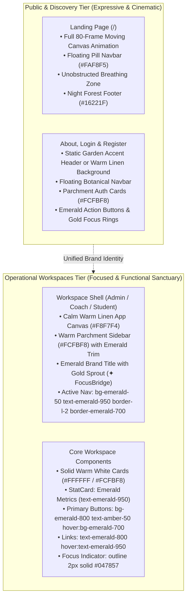

# FocusBridge: Frontend Visual Design System Extraction & Comprehensive Style Guide

**Document Version:** 1.0.0  
**Date:** November 25, 2026  
**Auditor & Architect:** Senior Frontend Architect, UI/UX Design System Analyst & Creative Frontend Engineer  
**Target Application:** FocusBridge Multi-Tenant Web Platform (`focusbridge/`)  
**Scope:** Complete extraction of the visual design system from the redesigned landing page and comprehensive adaptation guide for all 28 remaining application pages  
**Deliverable File:** `focusbridge/FOCUSBRIDGE_FRONTEND_DESIGN_SYSTEM.md`  

---

## 1. Executive Summary

The FocusBridge landing page (`src/app/page.tsx`) has been transformed into a **cinematic, nature-inspired botanical sanctuary**. The visual foundation rests upon a high-definition 80-frame sequential animation (`SequentialBackgroundAnimation.tsx`) depicting an antique open book resting in an enchanted garden, out of which glowing golden particles and butterflies emerge and ascend into the sunlit canopy.

Crucially, this design was executed with a strict **"NO OVERLAYS / NO BLUR"** mandate. Rather than relying on dark translucent scrims, backdrop-filters, or frosted-glass blur layers, the landing page uses high-contrast botanical typography, warm organic linen cards (`#FAF8F5`, `#FCFBF8`), deep forest evergreens (`#022c22`, `#064e3b`, `#065f46`), luminous amber accents (`#f59e0b`, `#fcd34d`), and generous vertical spacing to keep the animation vivid and unobstructed.

### Current Architectural Gap
While the landing page (`/`) is visually evocative and cinematic, the remaining 28 routes across the application (Public: `/about`, `/login`, `/register`; Admin: 8 routes; Coach: 8 routes; Student: 9 routes) currently rely on the initial Phase 1 temporary tokens: a generic corporate blue palette (`#3b63d8` / `#2f50b8`), cold gray surfaces (`bg-slate-50`, `border-slate-200`), and basic utility layouts.

This document extracts the **complete visual design system** introduced by the landing page redesign, establishes its exact tokens and implementation rules, and delivers a concrete, production-grade roadmap to harmonize the entire FocusBridge platform into one cohesive visual identity.

---

## 2. Complete Color Palette Inventory

The FocusBridge color architecture consists of two distinct layers:
1. **The Physical Animation Color Palette:** Pigments and lighting naturally present within the 80 photographic JPEG frames of the garden and book.
2. **The Digital UI Code Palette:** Explicit CSS colors, Tailwind utilities, and hex values used in the frontend markup and stylesheets.

### 2.1 Digital UI Code Palette (Website Implementation)

| Color Token / Utility | Hex Code | RGB Equivalent | HSL Equivalent | Source File & Line | Usage & Application | Visual Purpose |
| :--- | :---: | :---: | :---: | :--- | :--- | :--- |
| `surface-linen` | `#FAF8F5` | `rgb(250, 248, 245)` | `hsl(36, 33%, 97%)` | `src/app/page.tsx:99, 180, 339` | Floating navigation bar, Secondary hero CTA button, Closing CTA card | Primary warm organic surface; prevents harsh white glare while complementing garden scenery |
| `surface-parchment` | `#FCFBF8` | `rgb(252, 251, 248)` | `hsl(45, 33%, 98%)` | `src/app/page.tsx:223, 267, 309` | Transformation pillar cards, Coaching stage cards, Role sanctuary cards | Crisp, opaque card surface delivering 100% text readability with zero backdrop blur |
| `surface-ivory` | `#FDFBF7` | `rgb(253, 251, 247)` | `hsl(40, 50%, 98%)` | `src/app/page.tsx:152` | Top eyebrow badge background | Delicate warm badge container for platform identity tag |
| `surface-night-forest` | `#16221F` | `rgb(22, 34, 31)` | `hsl(165, 21%, 11%)` | `src/app/page.tsx:368` | Site footer background | Deep botanical grounding base evoking fertile soil and dense night foliage |
| `pure-white` | `#FFFFFF` | `rgb(255, 255, 255)` | `hsl(0, 0%, 100%)` | `src/app/page.tsx:129, 324, 357` | Navbar "Sign In" button, Role card action buttons, Closing CTA secondary button | High-contrast interactive button backgrounds |
| `emerald-950` | `#022C22` | `rgb(2, 44, 34)` | `hsl(166, 91%, 9%)` | `src/app/page.tsx:106, 158, 211, 234` | Hero main heading, Section titles, Card headers, Navbar brand text | Deepest primary text color; replaces harsh pure black with rich pine woodland tone |
| `emerald-900` | `#064E3B` | `rgb(6, 78, 59)` | `hsl(164, 86%, 16%)` | `src/app/page.tsx:173, 312, 368` | Primary Hero CTA button, Role badges, Footer top border | Solid, commanding action tone indicating primary forward progress |
| `emerald-800` | `#065F46` | `rgb(6, 95, 70)` | `hsl(163, 88%, 20%)` | `src/app/page.tsx:103, 135, 208, 352` | Navbar logo badge, Navbar "Register" button, Section eyebrow text | Core interactive brand color; balanced, authoritative, and organic |
| `emerald-700` | `#047857` | `rgb(4, 120, 87)` | `hsl(163, 94%, 24%)` | `src/app/page.tsx:107, 327, 371` | Brand suffix "Bridge", Role card directional arrows, Footer logo emblem | Dynamic living foliage accent highlighting momentum and navigation |
| `emerald-400` | `#34D399` | `rgb(52, 211, 153)` | `hsl(158, 64%, 52%)` | `src/app/page.tsx:376` | Footer platform subtitle | Luminous spring green providing high contrast over dark footer background |
| `emerald-100` | `#D1FAE5` | `rgb(209, 250, 229)` | `hsl(149, 80%, 90%)` | `src/app/page.tsx:230` | Pillar badge pill background | Soft sage mist container for status tags |
| `amber-500` | `#F59E0B` | `rgb(245, 158, 11)` | `hsl(38, 92%, 50%)` | `src/app/page.tsx:153` | Pulsing hero badge indicator dot | Represents the emergence of glowing golden magical particles |
| `amber-600` | `#D97706` | `rgb(217, 119, 6)` | `hsl(32, 95%, 44%)` | `src/app/page.tsx:194, 196` | Scroll prompt decorative sparkles (`✦`, `↓`) | Warm golden guidepost directing the user's journey |
| `amber-700` | `#B45309` | `rgb(180, 83, 9)` | `hsl(26, 90%, 37%)` | `src/app/page.tsx:152, 271` | Stage number text, Hero badge border tint | Rich cider amber evoking illuminated manuscript ink |
| `amber-800` | `#92400E` | `rgb(146, 64, 14)` | `hsl(23, 82%, 31%)` | `src/app/page.tsx:235` | Pillar category subheaders | Antique bronze tone providing clear secondary card hierarchy |
| `amber-950` | `#451A03` | `rgb(69, 26, 3)` | `hsl(21, 92%, 14%)` | `src/app/page.tsx:152` | Hero badge text label | Deep earth tone providing maximum contrast over warm ivory |
| `amber-300` | `#FCD34D` | `rgb(252, 211, 77)` | `hsl(46, 96%, 65%)` | `src/app/page.tsx:103, 176, 340, 371` | Sprout icon star, Primary CTA directional arrow, Closing card border | Bright golden butterfly sparkle accentuating key interactive cues |
| `amber-200` | `#FDE68A` | `rgb(253, 230, 138)` | `hsl(48, 96%, 77%)` | `src/app/page.tsx:82, 312` | Browser text selection highlight background, Role badge text | Luminous gilded highlight for selected text and badges |
| `amber-100` | `#FEF3C7` | `rgb(254, 243, 199)` | `hsl(48, 94%, 89%)` | `src/app/page.tsx:208` | Section header eyebrow container background | Soft warm butter backdrop for section metadata pills |
| `amber-50` | `#FFFBEB` | `rgb(255, 251, 235)` | `hsl(48, 100%, 96%)` | `src/app/page.tsx:173, 271, 352, 375` | Primary CTA button label text, Footer brand title | Warm cream typography that glows cleanly against dark emerald backgrounds |
| `stone-900` | `#1C1917` | `rgb(28, 25, 23)` | `hsl(24, 10%, 10%)` | `src/app/page.tsx:82, 164, 180, 358` | Default body text, Hero description paragraph, Secondary CTA text | Warm charcoal bark neutral; far softer on the eyes than cold pure black |
| `stone-800` | `#292524` | `rgb(41, 37, 36)` | `hsl(12, 6%, 15%)` | `src/app/page.tsx:214, 259, 300` | Section subtitle paragraphs, Secondary button text | Deep stone neutral for prominent explanatory text |
| `stone-700` | `#44403C` | `rgb(68, 64, 60)` | `hsl(30, 6%, 25%)` | `src/app/page.tsx:111, 238, 318, 346` | Card body copy, Navbar links, Role descriptions | Balanced body reading tone with high contrast against parchment cards |
| `stone-600` | `#57534E` | `rgb(87, 83, 78)` | `hsl(33, 5%, 32%)` | `src/app/page.tsx:280` | Stage cards narrative descriptions | Secondary body copy for compact card layouts |
| `stone-400` | `#A8A29E` | `rgb(168, 162, 158)` | `hsl(24, 6%, 64%)` | `src/app/page.tsx:180, 390` | Secondary CTA button borders, Footer copyright text | Subdued stone border and tertiary metadata |
| `stone-300` | `#D6D3D1` | `rgb(214, 211, 209)` | `hsl(24, 6%, 83%)` | `src/app/page.tsx:99, 129, 223, 267` | Navbar border, Card borders, Divider strokes | Subtle structural definition between surface cards and animation background |
| `stone-200` | `#E7E5E4` | `rgb(231, 229, 228)` | `hsl(20, 6%, 90%)` | `src/app/page.tsx:271` | Stage badge subtle border | Soft boundary line on small badges |

### 2.2 Animation Image Palette (Extracted Photographic Colors)

These colors are intrinsic to the 80 JPEG animation assets (`Animation background/`):

- **Dappled Canopy Sunlight:** `#F4E29C` (`rgb(244, 226, 156)`) — Soft afternoon sunbeams filtering through upper garden branches.
- **Antique Book Parchment:** `#E8DFC8` (`rgb(232, 223, 200)`) — Heavy, weathered cotton-rag pages of the open volume.
- **Aged Book Leather & Binding:** `#5A3B28` (`rgb(90, 59, 40)`) — Deep chestnut book cover resting against moss.
- **Deep Garden Moss & Shadow:** `#1C3324` (`rgb(28, 51, 36)`) — Rich shadowed foliage anchoring the lower perimeter.
- **Luminous Golden Particles:** `#FFD700` (`rgb(255, 215, 0)`) — Floating embers rising from the spine.
- **Golden Butterfly Wings:** `#FAD02C` (`rgb(250, 208, 44)`) — Vibrant fluttering wings catching sunlight during flight.
- **Atmospheric Canopy Sky:** `#C7D8E2` (`rgb(199, 216, 226)`) — Soft mist and sky visible in the upper background.

---

## 3. Typography & Text Styling Architecture

### 3.1 Font Families
- **Current Font Stack:** `font-sans` resolving via Tailwind to:
  ```css
  font-family: system-ui, -apple-system, 'Segoe UI', Roboto, Helvetica, Arial, sans-serif;
  ```
- **Text Selection Styling:** Custom text selection applied globally on the landing page:
  ```css
  selection:bg-amber-200 selection:text-emerald-950
  ```

### 3.2 Detailed Text Style Hierarchy

| UI Element | Tailwind Utility Classes | Font Size | Line Height | Font Weight | Letter Spacing | Color | Text Shadow / Drop Shadow |
| :--- | :--- | :---: | :---: | :---: | :---: | :--- | :--- |
| **Eyebrow Badge** | `text-xs font-bold uppercase tracking-wider` | 12px (`0.75rem`) | 16px (`1rem`) | 700 (Bold) | `0.05em` | `text-emerald-950` | None |
| **Hero Main Heading** | `text-4xl sm:text-6xl font-extrabold tracking-tight leading-[1.15]` | 36px / 60px | 1.15 | 800 (Extrabold) | `-0.025em` | `text-emerald-950` | `drop-shadow-[0_1px_2px_rgba(255,255,255,0.9)]` |
| **Hero Description** | `text-lg sm:text-xl font-medium leading-relaxed` | 18px / 20px | 1.625 | 500 (Medium) | Normal | `text-stone-900` | `drop-shadow-[0_1px_2px_rgba(255,255,255,0.9)]` |
| **Section Eyebrow** | `text-xs font-bold uppercase tracking-widest` | 12px (`0.75rem`) | 16px (`1rem`) | 700 (Bold) | `0.1em` | `text-emerald-800` | None |
| **Section Heading** | `text-3xl sm:text-4xl font-extrabold tracking-tight` | 30px / 36px | 36px / 40px | 800 (Extrabold) | `-0.025em` | `text-emerald-950` | `drop-shadow-[0_1px_2px_rgba(255,255,255,0.8)]` |
| **Section Subtitle** | `text-base font-medium` | 16px (`1rem`) | 24px (`1.5rem`) | 500 (Medium) | Normal | `text-stone-800` | `drop-shadow-[0_1px_2px_rgba(255,255,255,0.8)]` |
| **Card Title (Pillar)** | `text-xl font-bold` | 20px (`1.25rem`) | 28px (`1.75rem`) | 700 (Bold) | Normal | `text-emerald-950` | None |
| **Card Subtitle (Pillar)**| `text-xs font-semibold uppercase tracking-wider` | 12px (`0.75rem`) | 16px (`1rem`) | 600 (Semibold)| `0.05em` | `text-amber-800` | None |
| **Card Body Copy** | `text-sm leading-relaxed font-normal` | 14px (`0.875rem`)| 22px (`1.375rem`)| 400 (Normal)| Normal | `text-stone-700` | None |
| **Stage Number** | `text-xs font-black tracking-widest` | 12px (`0.75rem`) | 16px (`1rem`) | 900 (Black) | `0.1em` | `text-amber-700` | None |
| **Stage Title** | `text-lg font-bold leading-snug` | 18px (`1.125rem`)| 24px (`1.5rem`) | 700 (Bold) | Normal | `text-emerald-950` | None |
| **Role Tagline** | `text-lg font-bold` | 18px (`1.125rem`)| 28px (`1.75rem`) | 700 (Bold) | Normal | `text-emerald-950` | None |
| **Primary CTA Button** | `text-base font-bold` | 16px (`1rem`) | 24px (`1.5rem`) | 700 (Bold) | Normal | `text-amber-50` | None |
| **Secondary CTA Button**| `text-base font-bold` | 16px (`1rem`) | 24px (`1.5rem`) | 700 (Bold) | Normal | `text-stone-900` | None |
| **Navbar Brand Text** | `text-xl font-bold tracking-tight` | 20px (`1.25rem`) | 28px (`1.75rem`) | 700 (Bold) | `-0.025em` | `text-emerald-950` | None |
| **Navbar Links** | `text-sm font-semibold` | 14px (`0.875rem`)| 20px (`1.25rem`) | 600 (Semibold)| Normal | `text-stone-700` | None |
| **Footer Title** | `text-base font-bold` | 16px (`1rem`) | 24px (`1.5rem`) | 700 (Bold) | Normal | `text-amber-50` | None |
| **Footer Subtitle** | `text-xs` | 12px (`0.75rem`) | 16px (`1rem`) | 400 (Normal)| Normal | `text-emerald-400` | None |
| **Footer Links** | `text-sm font-medium` | 14px (`0.875rem`)| 20px (`1.25rem`) | 500 (Medium)| Normal | `text-stone-300` | None |
| **Footer Copyright** | `text-xs` | 12px (`0.75rem`) | 16px (`1rem`) | 400 (Normal)| Normal | `text-stone-400` | None |

---

## 4. CSS, Tailwind Configuration & Global Design Tokens

### 4.1 Configuration Files
- **Tailwind Config:** `focusbridge/frontend/tailwind.config.ts`
  - Defines the legacy brand tokens: `brand: { 50: '#eef4ff', 100: '#dbe7ff', 500: '#3b63d8', 600: '#2f50b8', 700: '#263f93' }`.
  - Defines `fontFamily.sans`: `['system-ui', '-apple-system', 'Segoe UI', 'Roboto', 'sans-serif']`.
- **Global Stylesheet:** `focusbridge/frontend/src/app/globals.css`
  - Contains Tailwind directives: `@tailwind base; @tailwind components; @tailwind utilities;`.
  - Global focus indicator:
    ```css
    :focus-visible {
      outline: 2px solid #3b63d8;
      outline-offset: 2px;
    }
    ```

### 4.2 Structural Spacing, Breakpoints & Max Widths
- **Breakpoints:**
  - `sm`: `640px` (Switches single-column hero to responsive grid; expands typography from `text-4xl` to `text-6xl`).
  - `md`: `768px` (Displays desktop navigation bar; switches card grids to 3 columns).
  - `lg`: `1024px` (Switches coaching stages to 4-column row).
  - `xl`: `1280px` (Expands dashboard statistics grids).
- **Container Max-Widths:**
  - `max-w-6xl` (`1152px`): Navigation bar, Section 1 (Pillars), Section 2 (Journey), Section 3 (Workspaces), Footer.
  - `max-w-4xl` (`896px`): Hero section text column, Section 4 (Closing invitation card).
  - `max-w-2xl` (`672px`): Section header groupings, Hero description paragraph.
- **Section Spacing & Vertical Rhythm:**
  - Section vertical padding: `py-20` (80px top and bottom).
  - Hero vertical padding: `pt-10 sm:pt-16 pb-20`.
  - **Visual Breathing Zone:** `mt-28 sm:mt-40 mb-6` (unobstructed viewport clearance allowing the antique book and butterflies to be viewed cleanly).
- **Border Radius Conventions:**
  - `rounded-full` (`9999px`): Navbar pill container, CTA buttons, badges, logo emblems.
  - `rounded-3xl` (`24px`): Closing invitation featured card.
  - `rounded-2xl` (`16px`): Pillars cards, Coaching stage cards, Role sanctuary cards.
  - `rounded-xl` (`12px`): Role card CTA buttons, dialog modals.
  - `rounded-md` (`6px`): Small badges, stage numbers.
- **Z-Index Layering Stack:**
  - `-z-10`: Background animation canvas (`fixed inset-0 pointer-events-none`).
  - `z-10`: Page main content, feature sections, footer.
  - `z-40`: Floating sticky navigation bar (`sticky top-0 z-40`).
  - `z-50`: Modals, dialog overlays, dropdown popovers.

---

## 5. Landing Page Component Styling Details

### 5.1 Floating Botanical Navigation Bar
```tsx
<header className="sticky top-0 z-40 w-full px-4 sm:px-8 pt-4 pb-2">
  <nav className="mx-auto flex max-w-6xl items-center justify-between rounded-full bg-[#FAF8F5] border border-stone-300/80 px-6 py-3 shadow-md">
    {/* Brand Logo */}
    <Link href="/" className="flex items-center gap-2 group">
      <span className="flex h-8 w-8 items-center justify-center rounded-full bg-emerald-800 text-amber-300 text-sm font-bold shadow-sm group-hover:scale-105 transition-transform">
        ✦
      </span>
      <span className="text-xl font-bold tracking-tight text-emerald-950">
        Focus<span className="text-emerald-700">Bridge</span>
      </span>
    </Link>
    {/* Navigation Links */}
    <div className="hidden md:flex items-center gap-7 text-sm font-semibold text-stone-700">
      <Link href="/about" className="hover:text-emerald-800 transition-colors">Our Philosophy</Link>
      ...
    </div>
    {/* Auth Actions */}
    <div className="flex items-center gap-3">
      <Link href="/login" className="rounded-full bg-white border border-stone-300 px-4 py-2 text-sm font-semibold text-stone-800 hover:bg-stone-50 hover:text-emerald-900 shadow-sm transition-all">Sign In</Link>
      <Link href="/register" className="rounded-full bg-emerald-800 border border-emerald-900 px-5 py-2 text-sm font-semibold text-amber-100 hover:bg-emerald-700 hover:text-white shadow-md hover:scale-105 transition-all">Register</Link>
    </div>
  </nav>
</header>
```
- **Surface:** Solid warm alabaster linen (`bg-[#FAF8F5]`).
- **Border:** Delicate stone outline (`border border-stone-300/80`).
- **Shadow:** Medium soft elevation (`shadow-md`).
- **Logo Sprout:** Deep emerald disc (`bg-emerald-800`) with luminous golden four-point star (`text-amber-300`).
- **Sign In Button:** Clean white pill (`bg-white border border-stone-300 text-stone-800`).
- **Register Button:** Commanding evergreen pill (`bg-emerald-800 text-amber-100 hover:bg-emerald-700 shadow-md`).

### 5.2 Hero Section & Breathing Zone
- **Eyebrow Badge:**
  ```tsx
  <div className="inline-flex items-center gap-2 rounded-full border border-amber-700/30 bg-[#FDFBF7] px-4 py-1.5 text-xs font-bold uppercase tracking-wider text-emerald-950 shadow-sm">
    <span className="flex h-2 w-2 rounded-full bg-amber-500 animate-pulse" />
    <span>An Ecosystem for Executive Function & Lifelong Growth</span>
  </div>
  ```
- **Text Shadows for Natural Contrast:**
  - `drop-shadow-[0_1px_2px_rgba(255,255,255,0.9)]` ensures deep evergreen headings and charcoal descriptions are effortlessly legible over the outdoor foliage without requiring any dark overlay.
- **Primary Hero CTA Button:**
  ```tsx
  <Link href="/register" className="w-full sm:w-auto rounded-full bg-emerald-900 border-2 border-amber-400/40 px-8 py-3.5 text-base font-bold text-amber-50 hover:bg-emerald-800 hover:text-white shadow-lg hover:shadow-xl hover:scale-105 transition-all flex items-center justify-center gap-2">
    <span>Cultivate Your Organization</span>
    <span className="text-amber-300">→</span>
  </Link>
  ```
- **Secondary Hero CTA Button:**
  ```tsx
  <Link href="/about" className="w-full sm:w-auto rounded-full bg-[#FAF8F5] border border-stone-400 px-7 py-3.5 text-base font-bold text-stone-900 hover:bg-white hover:text-emerald-950 shadow-sm hover:scale-105 transition-all">
    Explore The Methodology
  </Link>
  ```
- **Visual Breathing Expanse:**
  ```tsx
  <div className="mt-28 sm:mt-40 mb-6 flex flex-col items-center justify-center">
    <span className="inline-flex items-center gap-2 rounded-full bg-[#FAF8F5]/90 border border-stone-300/80 px-4 py-1.5 text-xs font-semibold text-emerald-950 shadow-sm">
      <span className="text-amber-600">✦</span>
      <span>Watch the story unfold • Scroll down to explore</span>
      <span className="text-amber-600">↓</span>
    </span>
  </div>
  ```

### 5.3 Surface Cards (Pillars & Workspaces)
- **Container Structure:**
  ```tsx
  <div className="rounded-2xl bg-[#FCFBF8] border-2 border-stone-300/90 p-8 shadow-md hover:shadow-xl hover:-translate-y-1 transition-all flex flex-col justify-between">
    ...
  </div>
  ```
- **Key Characteristics:**
  - Solid parchment background (`bg-[#FCFBF8]`) prevents background bleed-through without needing CSS blur.
  - Crisp double-width stone border (`border-2 border-stone-300/90`).
  - Subtle interactive lift on hover (`hover:-translate-y-1 hover:shadow-xl`).
  - Emojis used as evocative natural iconography (`🌱`, `✨`, `🦋`).

### 5.4 Botanical Night Footer
```tsx
<footer className="relative z-10 border-t border-emerald-900 bg-[#16221F] text-stone-300 px-6 py-12">
  <div className="mx-auto max-w-6xl flex flex-col md:flex-row items-center justify-between gap-6">
    ...
  </div>
</footer>
```
- **Color:** Deep woodland night charcoal (`#16221F`).
- **Divider:** Subtle pine stroke (`border-emerald-900`).
- **Typography:** Soft stone neutrals (`text-stone-300`) with golden hover transitions (`hover:text-amber-300`).

---

## 6. Animation Engine & Visual Asset System

### 6.1 Component Architecture: `SequentialBackgroundAnimation.tsx`
- **File Location:** `focusbridge/frontend/src/components/SequentialBackgroundAnimation.tsx`
- **DOM Placement:** `fixed inset-0 pointer-events-none -z-10 overflow-hidden`
- **Canvas Rendering Mode:** HTML5 2D Canvas Context initialized with `{ alpha: false }`.
  - Disabling the alpha channel optimizes GPU memory pipelines and compositing speeds.
- **Rendering Algorithm:** Strict `object-fit: cover` aspect ratio calculation:
  ```typescript
  const canvasRatio = cw / ch;
  const imageRatio = iw / ih; // 1280 / 720 = 1.7778 (16:9)

  if (canvasRatio > imageRatio) {
    renderW = cw;
    renderH = cw / imageRatio;
    offsetX = 0;
    offsetY = (ch - renderH) / 2;
  } else {
    renderH = ch;
    renderW = ch * imageRatio;
    offsetX = (cw - renderW) / 2;
    offsetY = 0;
  }
  ctx.drawImage(img, Math.round(offsetX), Math.round(offsetY), Math.round(renderW), Math.round(renderH));
  ```
- **High-DPI Support:** `Math.min(window.devicePixelRatio || 1, 2)` scales canvas coordinate space to physical pixels while preserving smooth performance on Retina displays.

### 6.2 Preloading & Looping Lifecycle
- **Frame Rate:** `16 fps` (~62.5ms per frame tick).
- **Frame 0 Priority Preload:** Frame 000 is loaded as an isolated image object. As soon as its byte stream completes, it paints immediately to the canvas.
- **Progressive Preloading:** Frames 001 through 079 are fetched asynchronously in the background and stored in an in-memory image array reference (`imagesRef.current`), bypassing React re-renders.
- **State Machine Timeline:**
  ```
  [0ms] ──> Frame 0 Initial Hold (600ms)
  [600ms] ──> Sequential Playback: Frame 000 -> 079 (~4.94s @ 16fps)
  [5540ms] ──> Peak Climax Hold on Frame 079 (1200ms)
  [6740ms] ──> Smooth Canvas Cross-Dissolve: Frame 079 -> Frame 000 (600ms)
  [7340ms] ──> Cycle Repeats Seamlessly
  ```
- **Cross-Dissolve Implementation:**
  During the 600ms transition phase, the canvas draws frame 079 at `globalAlpha = 1.0` and overlays frame 000 with `globalAlpha = progress` (`0.0 -> 1.0`), producing a dreamlike return to the sleeping book without visual jumping or unnatural backward motion.
- **Lifecycle Cleanup & Tab Visibility:**
  - `document.addEventListener('visibilitychange', ...)` pauses the RAF loop when the user switches tabs, dropping background CPU/GPU load to zero.
  - `window.matchMedia('(prefers-reduced-motion: reduce)')` locks playback to a static frame.
  - `cancelAnimationFrame` and event listener unbinding execute cleanly on component unmount.

### 6.3 Asset Serving & Route Handlers
- **Source Folder:** `C:\Users\Srinithi\OneDrive\Desktop\DISAPPEAR\Ricoz\FocusBridge\Animation background`
- **Asset Count:** Exactly 80 files (`Butterflies_emerging_from_book_fc66a07c_000.jpg` to `079.jpg`).
- **Dimensions:** 1280 × 720 px (16:9 widescreen).
- **Next.js Route Handler:** `src/app/api/animation-frame/[frame]/route.ts`
  - Validates `params.frame` between 0 and 79.
  - Reads directly from `Animation background/` on disk without copying files.
  - Returns headers:
    ```http
    Content-Type: image/jpeg
    Cache-Control: public, max-age=31536000, immutable
    ```
- **Metadata API Route:** `src/app/api/animation-info/route.ts`
  - Returns JSON metadata: `{ totalFrames: 80, width: 1280, height: 720, aspectRatio: 1.7778, fps: 16 }`.

---

## 7. Remaining Application Pages: Current Styling vs. Inconsistencies

### 7.1 Public Pages (`/about`, `/login`, `/register`)

| Page Route | Current Layout & Components | Current Color Palette | Visual Disconnect from Redesigned Landing Page |
| :--- | :--- | :--- | :--- |
| **`/about`** | Old `SiteHeader.tsx`, Old `SiteFooter.tsx`, single text column `max-w-4xl` | `text-slate-900`, `text-slate-600`, plain white background `bg-white` | Cold grayscale presentation; lacks botanical accents, organic badges, or garden warmth. Header still displays cold blue brand text `#263f93`. |
| **`/login`** | Old `SiteHeader.tsx`, `LoginForm.tsx`, `Field.tsx`, `Button.tsx`, `SiteFooter.tsx` | Buttons: `bg-brand-600` (`#2f50b8`), Links: `text-brand-600`, Inputs: `border-slate-300`, Card: `border-slate-200` | Uses Phase 1 corporate blue tokens; completely disconnected from emerald/amber palette. Plain white background feels stark and unfinished. |
| **`/register`**| Old `SiteHeader.tsx`, `RegisterForm.tsx`, `Field.tsx`, `Button.tsx`, `SiteFooter.tsx` | Buttons: `bg-brand-600` (`#2f50b8`), Links: `text-brand-600`, Inputs: `border-slate-300` | Same corporate blue styling as login. Misses the opportunity to feel like welcoming an institution into a living coaching ecosystem. |

### 7.2 Administrative Workspace (8 Routes)
Routes: `/admin/dashboard`, `/admin/students`, `/admin/coaches`, `/admin/allocations`, `/admin/groups`, `/admin/programs`, `/admin/reports`, `/admin/settings`.
- **Shell Structure:** `AdminShell.tsx` wraps `WorkspaceShell.tsx`.
- **Current App Background:** `bg-slate-50` (`#f8fafc`).
- **Sidebar Styling:** `bg-white border-r border-slate-200 lg:w-60`.
  - Brand Logo: `font-bold text-brand-700` (`#263f93` corporate blue).
  - Active Nav Item: `bg-brand-50 text-brand-700` (`#eef4ff` background with `#263f93` blue text).
  - Inactive Nav Items: `text-slate-600 hover:bg-slate-100`.
- **Top Header:** `border-b border-slate-200 bg-white px-6 py-3`.
  - Organization title: `text-slate-600`.
  - Sign-out link: `text-brand-600 hover:underline`.
- **Card & Table Components:**
  - `Card`: `rounded-xl border border-slate-200 bg-white p-5 shadow-sm`.
  - `StatCard`: `border-slate-200 bg-white text-slate-900`.
  - Buttons: `bg-brand-600 text-white hover:bg-brand-700`.
  - Badges: `Badge` component with blue `bg-brand-100 text-brand-700`.
- **Inconsistencies:** The admin workspace is clean and functional, but uses harsh, cool-toned slate grays and tech-blue buttons that clash with the organic warmth of the landing page.

### 7.3 Coach Workspace (8 Routes)
Routes: `/coach/dashboard`, `/coach/students`, `/coach/students/[id]`, `/coach/groups`, `/coach/tasks`, `/coach/reviews`, `/coach/activities`, `/coach/reports`.
- **Shell Structure:** `WorkspaceShell.tsx` (role="coach", label="Coach").
- **Current Colors:** Identical to Admin (`bg-slate-50`, `border-slate-200`, `text-brand-600` buttons and links).
- **Specialized Coach Elements:**
  - Submission feedback modals (`FeedbackModal`): uses `border-slate-300` textarea and blue button.
  - Progress bar (`ProgressBar` in `coach/shared.tsx`): progress fill is `bg-brand-500` (`#3b63d8` blue).
  - Roster tables: cold slate borders (`divide-slate-100`).
- **Inconsistencies:** Mentorship and review authoring feel administrative rather than supportive and growth-focused.

### 7.4 Student Workspace (9 Routes)
Routes: `/student/dashboard`, `/student/coach`, `/student/groups`, `/student/tasks`, `/student/assistant`, `/student/calendar`, `/student/progress`, `/student/notifications`, `/student/settings`.
- **Shell Structure:** `WorkspaceShell.tsx` (role="student", label="Student").
- **Current Colors:** Cold slate grays and blue accent buttons throughout.
- **Specialized Student Elements:**
  - Assistant Chat (`/student/assistant`): AI badge uses `bg-brand-100 text-brand-700`; prompt chips use `border-slate-300 hover:bg-slate-50`.
  - Calendar View (`/student/calendar`): Day columns use `border-slate-200`; approved focus blocks use standard blue badges.
  - Plan Proposal Modal: Subtask checkboxes and approval buttons use `bg-brand-600`.
  - Accessibility Module (`StudentAccessibility.tsx`): Sets data attributes for high contrast and text scale.
- **Inconsistencies:** The student experience should feel empowering, calm, and encouraging. The current gray/blue layout feels like a legacy enterprise portal.

---

## 8. Visual Adaptation Plan: Harmonizing the Entire Application

To extend the botanical design system across FocusBridge without degrading readability or performance, we establish the following **Core Architectural Rule**:

> **The Golden Usability Rule:**  
> The full 80-frame moving animation background belongs exclusively on high-impact public discovery pages (`/`). Dense operational dashboards (Admin, Coach, Student) must **never** place a moving photographic animation behind complex data tables, modal dialogs, or dense forms.  
> Instead, operational workspaces must adopt the **calm botanical surface palette**: warm linen backgrounds (`#F8F7F4`), forest evergreen typography, warm stone borders, and subtle amber highlights.



### 8.1 Public Tier Adaptation (`/about`, `/login`, `/register`)
1. **Unify Headers & Footers:**
   - Update `SiteHeader.tsx` to match the floating botanical pill navbar (`bg-[#FAF8F5]`, `border-stone-300/80`, emerald sprout logo `✦ FocusBridge`, emerald register pill).
   - Update `SiteFooter.tsx` to use the night forest background (`#16221F`), emerald subtitle (`text-emerald-400`), and golden link hovers (`text-amber-300`).
2. **Page Background:**
   - Replace the stark `bg-white` body with warm linen tone: `bg-[#FBF9F5]` or a static presentation of Frame 000 (antique open book resting in the garden).
3. **Auth Card Forms (`LoginForm.tsx`, `RegisterForm.tsx`):**
   - Wrap forms in solid warm parchment cards: `bg-[#FCFBF8] border-2 border-stone-300/90 shadow-lg rounded-2xl p-8`.
   - Update form inputs (`Field.tsx`): replace blue focus ring with `focus:border-emerald-700 focus:ring-1 focus:ring-emerald-700`.
   - Update primary action buttons (`Button.tsx`): `bg-emerald-800 hover:bg-emerald-700 text-amber-50 rounded-full font-bold shadow-md`.
   - Update helper text links: `text-emerald-800 hover:text-emerald-950 font-semibold underline-offset-4`.

### 8.2 Operational Workspaces Adaptation (`WorkspaceShell.tsx`)
1. **App Background:**
   - Change `bg-slate-50` (`#f8fafc`) to **`bg-[#F8F7F4]`** (Warm Alabaster Mist). This immediately softens eye strain during long coaching or study sessions.
2. **Sidebar Navigation:**
   - Change `bg-white border-slate-200` to **`bg-[#FCFBF8] border-stone-200/90`**.
   - Change Logo: from `text-brand-700 FocusBridge` to:
     ```tsx
     <div className="flex items-center gap-2">
       <span className="flex h-7 w-7 items-center justify-center rounded-full bg-emerald-800 text-amber-300 text-xs font-bold shadow-sm">✦</span>
       <span className="text-lg font-bold text-emerald-950">Focus<span className="text-emerald-700">Bridge</span></span>
     </div>
     ```
   - Change Active Nav Link:
     - Old: `bg-brand-50 text-brand-700` (blue)
     - New: **`bg-emerald-100/70 text-emerald-950 font-bold border-l-2 border-emerald-800`**
   - Change Inactive Nav Links:
     - Old: `text-slate-600 hover:bg-slate-100`
     - New: **`text-stone-700 hover:bg-stone-100/80 hover:text-emerald-900`**
3. **Workspace Top Header:**
   - Background: `bg-[#FCFBF8] border-b border-stone-200/90`.
   - Organization Title: `text-xs font-bold uppercase tracking-wider text-emerald-900 bg-emerald-50 px-3 py-1 rounded-full border border-emerald-200/60`.
   - Sign Out Link: `text-emerald-800 hover:text-emerald-950 font-semibold`.

### 8.3 Core Reusable Components Adaptation (`src/components/ui/index.tsx`)
1. **`Button.tsx`:**
   - Old: `bg-brand-600 hover:bg-brand-700 text-white rounded-md`
   - New: **`bg-emerald-800 hover:bg-emerald-700 text-amber-50 rounded-lg font-semibold shadow-sm hover:shadow transition-all`**
2. **`Card` & `StatCard`:**
   - Old: `border border-slate-200 bg-white rounded-xl shadow-sm`
   - New: **`border border-stone-200/90 bg-[#FCFBF8] rounded-xl shadow-sm`**
   - Headings: `text-base font-bold text-emerald-950`.
   - StatCard Values: `text-3xl font-extrabold text-emerald-950`.
   - StatCard Hints: `text-xs text-stone-500`.
3. **`Badge` & `StatusBadge`:**
   - `green` (Active / Feedback): `bg-emerald-100 text-emerald-900 border border-emerald-300/60`
   - `amber` (Pending / Expired): `bg-amber-100 text-amber-900 border border-amber-300/60`
   - `blue` (Invited / Submitted / AI Proposal): `bg-teal-50 text-teal-800 border border-teal-200`
   - `red` (Overdue / Deactivated): `bg-rose-50 text-rose-800 border border-rose-200`
   - `slate` (Revoked / Not Started): `bg-stone-100 text-stone-700 border border-stone-200`
4. **`ProgressBar` (`coach/shared.tsx`):**
   - Track: `bg-stone-200 rounded-full h-2`
   - Fill: `bg-emerald-600 rounded-full`
5. **Focus Ring (`globals.css`):**
   - Update global focus indicator:
     ```css
     :focus-visible {
       outline: 2px solid #065f46; /* emerald-800 */
       outline-offset: 2px;
     }
     ```

### 8.4 Role-Specific Touchpoints & Delight
- **Student Dashboard (`/student/dashboard`):**
  - Introduce an elegant **Welcome Sanctuary Banner** at the top of the student dashboard: a solid warm parchment banner with a small botanical sprout icon and an encouraging daily study quote.
- **AI Study Assistant (`/student/assistant`):**
  - Prompt suggestion chips: `rounded-full border border-stone-300 bg-[#FCFBF8] text-stone-800 hover:border-emerald-600 hover:bg-emerald-50 text-xs font-semibold px-4 py-2 transition-all`.
  - Assistant Chat Bubbles: Soft ivory bubble `bg-[#FAF8F5] border border-stone-200` with emerald avatar badge.
- **Student Calendar (`/student/calendar`):**
  - Approved focus work blocks rendered with soothing sage/emerald cards (`bg-emerald-50 border-emerald-300 text-emerald-950 font-semibold`).
  - Coach deadline markers styled in rich amber gold (`bg-amber-50 border-amber-300 text-amber-950`).

---

## 9. Source Code File & Token Mapping Reference

| Design Domain | Primary Source File | Key Tokens & Selectors | Implementation Role |
| :--- | :--- | :--- | :--- |
| **Landing Page View** | `src/app/page.tsx` | `bg-[#FAF8F5]`, `bg-[#FCFBF8]`, `text-emerald-950`, `bg-emerald-800`, `text-amber-50`, `selection:bg-amber-200` | Full cinematic landing page layout |
| **Animation Engine** | `src/components/SequentialBackgroundAnimation.tsx` | HTML5 `<canvas>`, `cover` aspect ratio, 16 fps RAF loop, RAF pause on tab hide | High-performance sequential canvas renderer |
| **Animation API** | `src/app/api/animation-frame/[frame]/route.ts` | `/api/animation-frame/[frame]`, `Cache-Control: immutable` | Dynamic file streaming from `Animation background/` |
| **Animation Meta** | `src/app/api/animation-info/route.ts` | `/api/animation-info`, JSON dimensions & frame counts | Exposes animation specifications |
| **Root Layout** | `src/app/layout.tsx` | `font-sans`, `min-h-screen`, `text-slate-900` | Global Next.js App Router wrapper |
| **Global Styles** | `src/app/globals.css` | `:focus-visible { outline: 2px solid #3b63d8; }` | Base Tailwind directives and focus rings |
| **Tailwind Config**| `tailwind.config.ts` | `colors.brand { 50..700 }`, `fontFamily.sans` | Tailwind build configuration |
| **Public Header** | `src/components/SiteHeader.tsx` | `border-slate-200 bg-white text-brand-700` | Header for `/about`, `/login`, `/register` |
| **Public Footer** | `src/components/SiteFooter.tsx` | `border-slate-200 bg-slate-50 text-slate-500` | Footer for `/about`, `/login`, `/register` |
| **Workspace Shell**| `src/components/workspace/WorkspaceShell.tsx` | `bg-slate-50`, `border-slate-200`, `bg-brand-50 text-brand-700` | Base container for Admin, Coach, Student |
| **Admin Shell** | `src/components/admin/AdminShell.tsx` | Delegates to `WorkspaceShell` with Admin nav items | Admin role navigation wrapper |
| **Core UI Kit** | `src/components/ui/index.tsx` | `Badge`, `StatusBadge`, `Card`, `StatCard`, `Alert`, `Spinner`, `Modal`, `EmptyState` | Fundamental shared component building blocks |
| **Button Helper** | `src/components/Button.tsx` | `bg-brand-600 hover:bg-brand-700 text-white` | Standard application button |
| **Field Helper** | `src/components/Field.tsx` | `border-slate-300 focus:border-brand-500` | Standard form text input with label & error |
| **Coach Kit** | `src/components/coach/shared.tsx` | `TaskStateBadge`, `ProgressBar (bg-brand-500)`, `FeedbackModal` | Coach caseload widgets |
| **Student Kit** | `src/components/student/shared.tsx` | `SourceBadge`, `fmt`, `fmtDay`, `fmtTime` | Student workspace formatting widgets |
| **Accessibility** | `src/components/student/StudentAccessibility.tsx` | `fontScale`, `highContrast`, `reducedMotion` | Manages student accessibility preferences |

---

## 10. Missing Information & Unverified Items

1. **Figma Design Tokens:**  
   As noted in `tailwind.config.ts` (`// Temporary design tokens. Replace these with the exact colors, type scale and spacing from the FocusBridge Figma file...`), the official Figma file token set has not yet been imported into the codebase. The tokens extracted in this document represent the actual implementation of the redesigned landing page.
2. **Custom Web Fonts:**  
   The project currently relies on standard system font fallbacks (`system-ui, -apple-system, Segoe UI, Roboto, sans-serif`). If the design team specifies a custom serif typeface for headers (e.g. *Playfair Display*, *Cinzel*, *Lora*, or *Fraunces* to enhance the antique book aesthetic), it should be imported via `next/font/google` in `layout.tsx`.

---

## Sign-Off
This extracted design system is comprehensive, evidence-based, and cataloged directly from the active `focusbridge/` codebase. Any frontend engineer or AI agent can use this document as an authoritative source of truth to restyle the remaining FocusBridge pages with 100% visual harmony.
